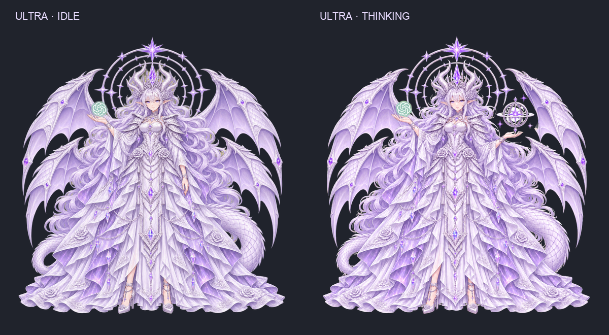

# GPT 桌宠 · Codex Desktop Pet

一个用 Swift / AppKit 编写的 macOS 桌面伙伴：随 Codex 的思考程度换形象，工作时施法，任务完成或中断后回到待机。

[English](README.en.md) · [源码与构建](SOURCE.md) · [代码许可](LICENSE) · [素材许可](ASSET_LICENSE.md)



## 能做什么

- Light、Medium、High、Extra High、Ultra 五档，各有待机和思考两种透明立绘。
- 读取 Codex 思考程度选择器；展开选择器并切换档位，不必发送消息。
- 使用插件 hooks 同步任务开始、完成和中断；多个聊天并行时，只要还有任务运行就保持思考姿态。
- 透明桌面窗口，可拖动、缩放、隐藏；包含呼吸、浮动、光环和粒子效果，并遵循 macOS「减少动态效果」。

这是独立社区项目，与 OpenAI 无隶属或背书关系。当前仓库提供 macOS 版；不包含 Windows 版。

## 安装

需要 Apple Silicon Mac、macOS 13 或更新版本、Xcode Command Line Tools、Python 3，以及支持 `codex plugin` 的 Codex CLI 和本机 Codex 桌面应用。当前构建目标为 arm64，不支持 Intel Mac。运行桌宠不需要 API key。

1. 克隆仓库或下载源码 ZIP，解压后在项目根目录打开终端。
2. 如尚未安装 Apple 开发工具，运行 `xcode-select --install`，完成系统安装后再继续。
3. 运行：

   ```sh
   zsh install-plugin.command
   ```

安装脚本先在本机构建并打包 `.app`，然后注册本地插件市场、安装 `gpt-desktop-pet@pitter-desktop-pets`。请保留源码目录，作为本地市场的来源。源码构建产物使用临时签名，未做 Apple 公证。

安装后，在 Codex 的 `/hooks` 中审核并信任 `UserPromptSubmit`、`Stop`、`Interrupt` 三个 hooks。若当前聊天未加载插件，重启 Codex 并打开新聊天。安装插件不会自动完成 hooks 信任。

提交一条本机任务，hooks 会启动桌宠。也可以手动打开构建生成的应用：

```sh
open 'macos/.build/apps.noindex/GPT 桌宠.app'
```

若已有另一个桌宠实例，请先退出它，再启动需要使用的那一份，避免给错误的副本授权。

## 连接思考程度

右键桌宠，开启「跟随 Codex」，点击「连接思考程度滑块…」。在「系统设置 → 隐私与安全性 → 辅助功能」允许**实际正在运行的 GPT 桌宠**。插件启动的是其安装目录中的应用；开发构建是另一份副本。

回到 Codex，保持窗口在前台，展开思考程度选择器，分别选择 Light 和 Ultra，每档停留约 1 秒。桌宠菜单显示「滑块已同步」即表示已读到控件；选择器收起后保留最后识别的档位。

应用使用临时签名。重建、更新或移动应用后，macOS 可能要求重新授权：退出旧版，删除辅助功能中的旧条目，再添加当前实际使用的 `.app` 并开启。只检查设置列表里的开关，不能证明当前运行副本已获得权限。

## 日常操作

| 操作 | 效果 |
| --- | --- |
| 拖动人物 | 移动位置 |
| 右键人物 | 选择档位、动作、大小、联动和动态效果 |
| 双击人物 | 手动切换待机／思考姿态 |
| 菜单栏星光图标 | 隐藏、显示、重置位置、退出 |

**档位决定形象，任务状态决定动作。**手动选档位会关闭「跟随 Codex」，重新勾选即可恢复；手动选动作和双击不会关闭档位联动，下一次任务事件会更新动作。

「思考中」表示任务仍在执行，包括使用工具的时间，并非模型内部推理的实时测量。所有聊天的最新任务都结束后才回到待机。

## 验证与排查

先运行 `codex plugin list --json`，确认 `gpt-desktop-pet@pitter-desktop-pets` 已安装且启用。

| 现象 | 检查方法 |
| --- | --- |
| 菜单显示「手动模式」 | 重新勾选「跟随 Codex」 |
| 显示需要辅助功能权限 | 给正在运行的安装副本授权；更新后必要时删除旧条目并重新添加 |
| 显示「尚未识别思考档位」 | 让 Codex 保持前台并展开选择器；新版控件结构可能需要适配 |
| 档位会变，但任务动作不变 | 在 `/hooks` 中确认三个 hooks 已信任，重启 Codex 后用新聊天测试 |
| 完成任务后仍在思考 | 检查其他聊天是否还在运行，以及是否收到 `Stop`／`Interrupt`；丢失结束事件时可能保留到六小时过期 |

可查看主进程自己的运行状态：

```sh
cat "$HOME/Library/Application Support/GPTCompanion/runtime-status.json"
```

重点看 `accessibilityTrusted`、`followCodex`、`selectionEffort`、`activity` 和 `activeSessionCount`。开启联动并授权后，在新聊天提交任务应看到 `activity` 变为 `thinking`；所有任务结束后应变回 `idle`。状态只在变化时写入；排查时也需确认 `pid` 对应仍在运行的桌宠。提交问题前请隐去 PID、会话／轮次标识等本机信息。

## 隐私与兼容性

应用本身不使用网络。辅助功能读取目标限于 Codex 的控件结构与思考档位，不获取或保存聊天文字。hooks 只写入会话 ID、轮次 ID、动作、档位和时间，位置为 `~/Library/Application Support/GPTCompanion/events/`；主进程状态写入其父目录的 `runtime-status.json`。

hooks 输入不包含思考程度。尚未读到选择器时，桥接脚本会按当前会话 ID，只读查询本机 `$CODEX_HOME/state_*.sqlite` 中的档位元数据；无记录时保留当前形象。辅助功能控件和此数据库都是兼容性依赖，Codex 更新后可能需要适配。

任务状态从新收到的 hooks 开始，不回放安装前已开始的任务；只在运行 hooks 的同一台 Mac 上显示，远程或云端任务不会自动同步。若结束事件丢失且该聊天没有后续轮次，思考状态可能持续到六小时过期。

## 开发

```sh
zsh macos/build.sh
python3 -B -m unittest discover -s tests -v
'macos/.build/apps.noindex/GPT 桌宠.app/Contents/MacOS/GPTCompanion' --self-test
```

需要将应用放入插件包时：

```sh
GPT_PET_PACKAGE_PLUGIN=1 zsh macos/build.sh
```

自检覆盖五档识别、十种渲染状态、动作联动、并发任务及旧事件处理；实际 Codex UI 兼容性和 macOS 权限仍需在目标机器上验证。结构、状态规则与贡献验证见 [SOURCE.md](SOURCE.md)。

## 许可与素材

代码采用 [MIT License](LICENSE)，角色图片、图标和预览采用 [CC BY 4.0](ASSET_LICENSE.md)。角色素材由 AI 辅助生成；Light、Medium、Ultra 的补绘提示词位于 `prompts/`。素材许可要求署名、保留许可链接并注明修改，不授予第三方商标权，也不代表 OpenAI 为本项目背书。
